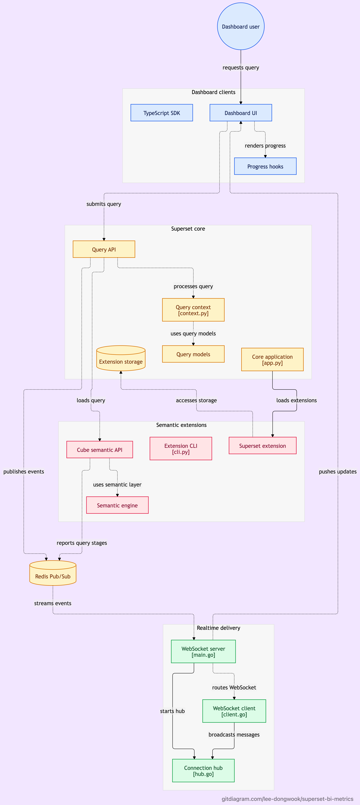

# superset-bi-metrics

Apache Superset과 Cube.js 오픈소스를 결합한 차세대 Headless BI Metrics 확장 및 실시간 처리 플랫폼 프로젝트입니다.

---

## 🏛️ 아키텍처 개요 (Superset x Cube.js x WebSocket)

Apache Superset의 시각화/대시보드 기능과 Cube.js의 Semantic Layer(단일 지표 정의, Pre-aggregations 캐싱 엔진)를 결합하고, Go 기반 WebSocket 및 Redis Pub/Sub을 통해 쿼리 실행/캐시 워밍 상태를 실시간으로 스트리밍합니다.

<p align="center">
  
</p>

<details>
<summary><b>상세 데이터 흐름 (Text Flow)</b></summary>

```
[ Superset Client (Web) ] 
       │ 
       │ 1. 쿼리 요청 (Query/Channel ID 발급)
       ▼
[ Core Backend / Cube Bridge ] ─── 2. Cube API 호출 (/cubejs-api/v1/load)
       │                                     │
       │                                     ▼ (continueWait: true / Stage 변경 감지)
       │ 3. Redis Pub/Sub 이벤트 발행        [ Cube.js / Cube Store ]
       │    (channel: "query_events")              (Pre-agg building, Executing SQL)
       ▼
[ Redis (Pub/Sub) ]
       │
       │ 4. Subscribe
       ▼
[ Go WebSocket Server ] (:8080)
       │ 5. 대상 Client에게만 실시간 푸시 (Topic/Channel 기반 유니캐스트)
       ▼
[ Superset Client ] ── 6. UI 실시간 갱신 (진행률 %, Pre-aggregation 워밍 상태, 완료 알림)
```

</details>

---

## 📁 프로젝트 구조 및 모듈 현황

| 모듈 / 디렉토리  | 기술 스택                   | 설명                                                                                                   |
| :--------------- | :-------------------------- | :----------------------------------------------------------------------------------------------------- |
| **`semantic/`**  | Cube.js, Rust               | 시맨틱 뷰 스키마 정의 및 Rust 코어 기반 고성능 모델링/쿼리 엔진 레이어                                 |
| **`websocket/`** | Go (gorilla/websocket)      | 실시간 이벤트 및 비동기 쿼리 알림을 위한 WebSocket 서버 (Hub 패턴, Redis Pub/Sub 연동, 세션 라우팅)   |
| **`core/`**      | Python (Flask, SQLAlchemy)  | Superset Core 앱, 비동기 쿼리 핸들러(`AsyncQueryHandle`), Cube 브릿지 API 스캐폴딩                     |
| **`client/`**    | TypeScript, React (pnpm)    | 대시보드/차트 프론트엔드 클라이언트 및 실시간 쿼리 프로그레스 Hook UI                                  |
| **`sdk/`**       | TypeScript                  | 클라이언트 애플리케이션 및 외부 연동용 TypeScript SDK                                                  |
| **`extension/`** | Python (FAB, SQLAlchemy)    | Superset Core 연동용 Extension 모델 인터페이스 (`CoreModel`, `Database` 등) 및 MCP 구조                |
| **`cli/`**       | Python (Click, Jinja2)      | Extension 템플릿 생성, 검증 및 번들링을 위한 CLI 도구                                                  |
| **`docker/`**    | Docker Compose              | 로컬 개발/테스트용 인프라 (PostgreSQL 15, Redis 7)                                                     |

---

## 📡 실시간 쿼리 이벤트 스키마 (Query Event Schema)

Cube.js의 쿼리 라이프사이클(`continueWait`, `stage`)과 Superset의 `QueryStatus`를 매핑한 JSON 규격:

```json
{
  "channel_id": "user-session-uuid-1234",
  "query_id": "qry-9876",
  "status": "RUNNING",
  "stage": {
    "step": "BUILDING_PRE_AGGREGATIONS",
    "description": "Building pre-aggregation: orders_summary_monthly",
    "progress_percent": 65,
    "elapsed_ms": 3200
  },
  "result_url": "/api/v1/chart/data/cache-key-123",
  "error": null
}
```

---

## 🚀 로컬 인프라 및 모듈 실행

### 1. 인프라 실행 (PostgreSQL & Redis)

```bash
docker compose -f docker/docker-compose.yaml up -d
```

### 2. WebSocket 서버 (Go)

```bash
cd websocket
make run        # 로컬 서버 실행 (:8080)
make test       # 단위 테스트 실행
```

---

## 📝 개발 진행 현황 및 로드맵

### 완료된 작업
- [x] Docker Compose 기반 PostgreSQL & Redis 로컬 인프라 구성
- [x] Extension Core 모델 인터페이스 및 MCP 데코레이터 초안 구성
- [x] Jinja2 템플릿 기반 CLI 스캐폴딩 구축
- [x] Go 기반 WebSocket 서버 레이어 구현 (Hub, Client 관리, Graceful shutdown, 단위 테스트)
- [x] Cube.js 시맨틱 스키마 및 Rust 코어 코드젠 스캐폴딩 (`semantic/`)

### 진행 중 / 예정 작업 (실시간 쿼리 스트리밍 파이프라인)
- [x] **Step 1**: Go WebSocket 서버에 Redis Pub/Sub 워커 및 채널(`channel_id`) 기반 세션 라우팅 구현
- [x] **Step 2**: Python Core에서 Cube.js 비동기 쿼리(`continueWait`) 및 Pre-aggregation 워밍 상태 Redis 발행 브릿지 구현
- [ ] **Step 3**: 프론트엔드 React Hook (`useQueryProgress`, `useWebSocket`) 및 상세 진행률 UI 컴포넌트 연동
